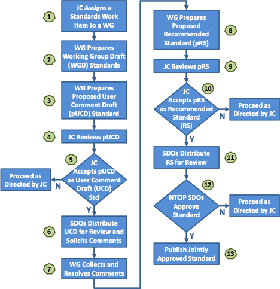

<!-- markdownlint-enable require-heading-body -->

# Procedures {.body}

## Procedures of the NTCIP JC {.body}

This section contains the procedures that primarily address activities of the NTCIP JC.

### Meeting procedures of the NTCIP JC {.body}

|**Parameter**              |**Value**                               |
|---------------------------|----------------------------------------|
|**Effective Date:**        |September 30, 2017                      |
|**Last Reviewed/Updated:** |September 30, 2026                      |

Much of the work of the NTCIP JC occurs in meetings. Meetings may take place in a face-to-face setting, through web conferencing or through a teleconference. The practices for conducting meetings of the NTCIP JC are described below.

#### Announcement of meetings {.body}

The NTCIP Coordinator must announce every meeting of the NTCIP JC in coordination with the NTCIP JC chair. The announcement must include the date, time, location, and agenda.

!!! question
    For review

Virtual meetings are to be announced at least two weeks in advance of the meeting. In-person meetings are to be announced at least six weeks in advance of the meeting.

Announcements must be made using the designated communication channels established for the NTCIP JC.

#### Parliamentary authority {.body}

The parliamentary authority of the NTCIP JC follows Robert's Rules of Order Newly Revised (RONR). RONR governs in all cases to which they are applicable and in which they are not inconsistent with this policies, processes and procedures document.

!!! question
    Do we want to soften this language? Robert's rules are rather strict and constraining, and in practice are not being followed that way in hardly any of the SDOs. Perhaps something like NTCIP groups are generally governed by consensus processes and rely on Robert's Rules of Order Newly Revised (RONR) when resolving conflicts and taking votes.

### NTCIP JC voting procedures {.body}

#### General {.body}

Votes on matters before the JC may be taken either within a meeting or through an electronic ballot. Votes must not be mixed between the two methods.

For votes conducted within a committee meeting, members who are unable to attend may submit their vote by correspondence in advance of the meeting. Such correspondence votes must be received by the NTCIP JC chair or the NTCIP Coordinator (or designated recipient) prior to the start of the meeting and will be counted as if the member were present.

For votes conducted within a committee meeting, a ballot cast may be from the voting member or the voting member's designated alternate, if the voting member is not present. [Proxy votes](general.md#terms) are not allowed.

For votes conducted electronically, the number of responses received must represent a quorum.

Unless otherwise specified, votes must be taken by [simple majority](general.md#terms).

!!! note
    The following actions vary from a simple majority.

    - Approval of a Recommended Standard (RS)
    - Approval of an Interim Document for Field Release (IFR)
    - [Creation of a new NTCIP group](procedures.md#creating-an-ntcip-group)
    - Removal of a NTCIP group chair or NTCIP group vice-chair

!!! question
    Are there any cases where we want to specify other measures, such as:

    - absolute majority: i.e., >50% of the voting membership (we would need to clarify what happens with an empty seat)
    - majority of those present: i.e., >50% of the voting members present at the meeting (which should probably be = to absolute majority with the exception of empty seats in the case of electronic ballots)

!!! question
    Review the following three ways to initiate a vote. Are they all valid?

#### JC Chair initiated votes {.body}

The chair of the NTCIP JC may initiate a vote on an issue according to the following procedure:

1. The chair must identify the question to be asked and the ballot method to use (e.g., electronic or in-person). The information must be sent to the NTCIP Coordinator.
2. The question will be announced to the voting membership either:
    - as an agenda item for the next meeting and followed by a period of discussion and voting at the meeting
    - via electronic means and followed by a minimum period of 30 days of discussion and two-weeks of voting

#### Group initiated votes {.body}

A group may initiate a vote within the NTCIP JC as a part of a task to which it has been assigned according to the following procedure:

1. A motion must be made by a voting member of the group to advance a report or document to its next stage through a vote by the NTCIP JC.
2. The motion must be seconded.
3. The motion must pass within the group by the required majority.
4. The request for a vote within the NTCIP JC must be recorded and communicated to the NTCIP JC chair and NTCIP Coordinator.
5. The NTCIP JC chair must identify the ballot method to use (e.g., electronic or in-meeting). The information must be sent to the NTCIP Coordinator.
6. The question will be announced to the NTCIP JC voting membership either:
    - as an agenda item for the next meeting at least two weeks in advance of the meeting and followed by a period of discussion and voting at the meeting
    - via electronic means and followed by a minimum period of 30 days of discussion and two-weeks of voting

#### Member requested votes {.body}

A voting member of the NTCIP JC may request to initiate a vote on any issue according to the following procedure:

1. A motion must be made by a voting member of the NTCIP JC that states the question to be asked and the ballot method to use (e.g., electronic or in-person). The motion may be made at a meeting or via electronic means.
2. The motion must be seconded.
3. The motion must pass by simple majority.
4. The question will be announced to the voting membership either:
    - at a meeting and followed by a period of discussion and voting at the meeting
    - as an agenda item for the next meeting and followed by a period of discussion and voting at the meeting
    - via electronic means and followed by a minimum period of two-weeks of voting

!!! note
    This process allows issues that arise at a meeting to be voted on immediately; however, it is greatly preferred to identify issues to be voted on in advance of a meeting and to announce them as an agenda item.

### Specific actions of the NTCIP JC {.body}

#### Creating an NTCIP group {.body}

|**Parameter**              |**Value**                               |
|---------------------------|----------------------------------------|
|**Effective Date:**        |September 30, 2017                      |
|**Last Reviewed/Updated:** |September 30, 2026                      |

There may be times when a work item to be undertaken by the NTCIP JC is not suitable for an existing NTCIP WG or that another NTCIP group is warranted. In this case, the NTCIP JC may create a new group by agreeing to and recording the following terms:

1. The need and scope for the new group
2. The work items to be assigned to the group
3. The NTCIP JC voting member that will act as the group's sponsor and support its activities
4. The number of members of each interest category to be assigned to the group

The decision to establish a new group requires at least a [two-thirds (2/3s) majority](general.md#terms).

Once established, the NTCIP JC chair assigns a chair and vice-chair of the group with input from the NTCIP JC, the SDO representatives and the NTCIP Coordinator. The NTCIP JC chair will then work with the group's chair and vice-chair to establish the group's initial voting membership.

#### JC assigns a work item to a WG {.body}

|**Parameter**              |**Value**                               |
|---------------------------|----------------------------------------|
|**Effective Date:**        |September 30, 2017                      |
|**Last Reviewed/Updated:** |September 30, 2026                      |

All documents developed under the oversight of the NTCIP JC begin with a proposal. Typically, a proposal comes from an existing NTCIP group but it may come from other sources such as a member of the NTCIP JC, an SDO, or the USDOT.

When a proposal is submitted to the Joint Committee, it must include the following details regarding the effort:

1. the sponsor of the proposal;
2. the working group, or other team, responsible for assisting the sponsor;
3. The [type of document](policies.md#types-of-documents) to be produced;
4. the scope of the proposed document;
5. an explanation of why the document is needed;
6. any related documents;
7. any related working groups;
8. the expected completion date; and
9. an estimate of any required financial assistance.

A proposal may also contain sample text for the document. The sample text can be anything from a few words to an entire draft.

Proposals are submitted to the NTCIP Joint Committee for approval; however, most proposals should be submitted through an appropriate working group in order to show a level of consensus for the proposal.

The decision to establish a new work item requires at least a [simple majority](general.md#terms).

If the JC chooses to go forward with the proposal, the project is assigned to an appropriate WG. If no appropriate WG exists, a [new working group may be formed](procedures.md#creating-an-ntcip-group). Once the work item is assigned to a WG and any preconditions for the proposal are met, then the proposal is approved and work may begin.

#### JC reviews document {.body}

|**Parameter**              |**Value**                               |
|---------------------------|----------------------------------------|
|**Effective Date:**        |September 30, 2026                      |
|**Last Reviewed/Updated:** |September 30, 2026                      |

When a document requires JC review, it is distributed to the NTCIP JC membership for review for a minimum of 30 days. Members should formulate comments and questions prior to the subsequent NTCIP JC meeting.

When the document is distributed for review, it must identify its associated approved work item and the group that prepared the document.

#### JC approves document for next stage {.body}

|**Parameter**              |**Value**                               |
|---------------------------|----------------------------------------|
|**Effective Date:**        |September 30, 2026                      |
|**Last Reviewed/Updated:** |September 30, 2026                      |

A meeting, web conference or teleconference is held where the WG Chair (and possibly a technical lead in the project) presents the document to the members of the NTCIP JC. The NTCIP JC asks the presentation team questions and makes comments based on their review. Any issue may be discussed regarding the document. The NTCIP JC may take a vote to advance the document to its next stage (e.g., UCD, RS, IFR). The question that is voted on may include direction to correct issues within the document prior to proceeding to the next stage. The amount of support required to pass a vote varies depending on the next stage of the work item, as follows:

- User Comment Draft (UCD): [simple majority](general.md#terms)
- Recommended Standard (RS): [two-thirds (2/3s) majority](general.md#terms)
- Interim Document for Field Release (IFR): [two-thirds (2/3s) majority](general.md#terms)

If the vote fails, the NTCIP JC will provide direction on how to proceed. This direction will typically indicate what revisions are required to make document acceptable to the NTCIP JC. The revisions may be to simply correct editorial items in the standard prior to a re-vote or there may be some more significant development to be done.

#### NTCIP JC Vacancies {.body}

!!! question
    I am not sure where this text came from. Do we want to keep?

|**Parameter**              |**Value**                               |
|---------------------------|----------------------------------------|
|**Effective Date:**        |September 30, 2017                      |
|**Last Reviewed/Updated:** |September 30, 2026                      |
| **History**               |This procedure on NTCIP JC Vacancies was established to provide the NTCIP JC the means to fill its own vacancies on the NTCIP JC if the SDOs are unable to do so. |

The procedures for membership and leadership and of the NTCIP JC are established in the MOU Section 1.0 Establishment of a Joint Committee. The MOU states that there are “18 voting members with 1/3rd each being designated by AASHTO, ITE, and NEMA.” While this is the intent, it is often the case that that an SDO is not able to immediately fill a vacancy when one occurs. In order for the NTCIP JC to be effective, its voting membership must be maintained. The steps below help ensure the NTCIP JC membership.

1. A vacancy on the NTCIP JC may be identified by an SDO or the NTCIP Chair when they are informed by a voting member that they will no longer be participating in that capacity. A potential vacancy may also be identified by the NTCIP Chair when a voting member has not participated in three consecutive NTCIP JC meetings.
2. The SDO that has the vacancy on the NTCIP JC is allowed up to one year to fill a vacancy.
3. If the SDO does not fill the vacancy in one year, the NTCIP JC Chair may nominate a representative pro tem to fill the vacancy. The representative pro tem must be a member (or representative of a member organization) of the SDO that has the vacancy on the NTCIP JC. The NTCIP JC must confirm the nomination by simple majority.

## Procedures of the NTCIP groups {.body}

This section contains the procedures that primarily address activities of the NTCIP groups.

### Meeting procedures of NTCIP groups {.body}

|**Parameter**              |**Value**                               |
|---------------------------|----------------------------------------|
|**Effective Date:**        |September 30, 2017                      |
|**Last Reviewed/Updated:** |September 30, 2026                      |

Much of the work of NTCIP groups occur in meetings. Meetings may take place in a face-to-face setting, through web conferencing or through a teleconference. The practices for conducting meetings of the NTCIP groups are described below.

#### Announcement of meetings {.body}

The NTCIP Coordinator must announce every meeting of each NTCIP group in coordination with the respective chair. The announcement must include the date, time, location, and agenda. 

!!! question
    For review

Virtual meetings are to be announced at least two weeks in advance of the meeting. In-person meetings are to be announced at least six weeks in advance of the meeting.

Announcements must be made using the designated communication channels established for the NTCIP group.

#### Parliamentary authority {.body}

The parliamentary authority of an NTCIP group follows Robert's Rules of Order Newly Revised (RONR). RONR governs in all cases to which they are applicable and in which they are not inconsistent with the policies, processes, and procedures defined in this document.

!!! question
    Do we want to soften this language? Robert's rules are rather strict and constraining, and in practice are not being followed that way in hardly any of the SDOs. Perhaps something like NTCIP groups are generally governed by consensus processes and rely on Robert's Rules of Order Newly Revised (RONR) when resolving conflicts and taking votes.

Acceptance Actions Between Meetings of the NTCIP WG: Acceptance actions by the NTCIP WG are those when a vote is taken to accept a WGD as a pUCD, pRS or pRE. Typically, acceptance actions are completed as part of an NTCIP WG meeting. There are circumstances, however, when the NTCIP WG may determine that it is prudent to complete an acceptance action outside of a meeting. This may be done because the NTCIP WG members need more time to review a proposed document before voting, there are not enough voting members at the meeting to perform the vote, or some other reason. In such cases, an electronic ballot may be used outside of the NTCIP WG meeting as follows:

1. A motion must be made that an electronic ballot be taken to accept the pUCD, pRS or pRE. The motion must be recorded at the meeting and include the details of when and how the ballot will be performed. Electronic balloting may include email, a polling website, or some other method.
2. The motion must be seconded.
3. The motion must pass by simple majority.
4. No split vote between a meeting and electronic voting is allowed. All voting must take place during a meeting NTCIP WG or electronically outside of the meeting but not both.

!!! question
    Should we move common text (e.g., simple majority) to a different section and then reference where needed?

### NTCIP group voting procedures {.body}

|**Parameter**              |**Value**                               |
|---------------------------|----------------------------------------|
|**Effective Date:**        |September 30, 2017                      |
|**Last Reviewed/Updated:** |September 30, 2026                      |

For votes conducted within a group meeting, members who are unable to attend may submit their vote by correspondence in advance of the meeting. Such correspondence votes must be received by the chair of the group or the NTCIP Coordinator (or designated recipient) prior to the start of the meeting and will be counted as if the member were present.

#### General {.body}

Votes on matters before an NTCIP group may be taken either within a meeting or through an electronic ballot. Votes must not be mixed between the two methods.

For votes conducted within a group meeting, members who are unable to attend may submit their vote by correspondence in advance of the meeting. Such correspondence votes must be received by the group chair or the NTCIP Coordinator (or designated recipient) prior to the start of the meeting and will be counted as if the member were present.

For votes conducted within a group meeting, a ballot cast may be from the voting member or the voting member's designated alternate, if the voting member is not present. [Proxy votes](general.md#terms) are not allowed.

Unless otherwise specified, votes must be taken by [simple majority](general.md#terms). 

!!! note
    The following actions vary from a simple majority.

    - Approval of a pre-Recommended Standard (pRS) as a Recommended Standard (RS)
    - Approval of a pre-Interim Document for Field Release (pIFR) for a new major version
    - Approval of an Interim Document for Field Release (IFR) for a minor version or patch version

!!! question
    Review the following ways to initiate a vote. Are they all valid?

#### Group chair initiated votes {.body}

The chair of the NTCIP group may initiate a vote on an issue according to the following procedure:

1. The chair must identify the question to be asked and the ballot method to use (e.g., electronic or in-person). The information must be sent to the NTCIP Coordinator. 
2. The question will be announced to the voting membership either:
    - as an agenda item for the next meeting and followed by a period of discussion and voting at the meeting
    - via electronic means and followed by a minimum period of 30 days of discussion and two-weeks of voting

#### Group initiated votes {.body}

A sub-group of the NTCIP group may initiate a vote within the NTCIP group as a part of a task to which it has been assigned according to the following procedure:

1. A motion must be made by a voting member of the sub-group to advance a report or document to its next stage through a vote by the NTCIP group. 
2. The motion must be seconded.
3. The motion must pass within the sub-group by the required majority.
4. The request for a vote within the NTCIP group must be recorded and communicated to the NTCIP group chair and NTCIP Coordinator.
5. The NTCIP group chair must identify the ballot method to use (e.g., electronic or in-meeting). The information must be sent to the NTCIP Coordinator. 
6. The question will be announced to the NTCIP group voting membership either:
    - as an agenda item for the next meeting at least two weeks in advance of the meeting and followed by a period of discussion and voting at the meeting
    - via electronic means and followed by a minimum period of 30 days of discussion and two-weeks of voting

#### Member requested votes {.body}

A voting member of the NTCIP group may request to initiate a vote on any issue according to the following procedure:

1. A motion must be made by a voting member of the NTCIP group that states the question to be asked and the ballot method to use (e.g., electronic or in-person). The motion may be made at a meeting or via electronic means. 
2. The motion must be seconded.
3. The motion must pass by simple majority.
4. The question will be announced to the voting membership either:
    - at a meeting and followed by a period of discussion and voting at the meeting
    - as an agenda item for the next meeting and followed by a period of discussion and voting at the meeting
    - via electronic means and followed by a minimum period of two-weeks of voting

!!! note
    This process allows issues that arise at a meeting to be voted on immediately; however, it is greatly preferred to identify issues to be voted on in advance of a meeting and to announce them as an agenda item.

### Specific actions of NTCIP groups {.body}

#### Group drafts/revises document {.body}

|**Parameter**              |**Value**                               |
|---------------------------|----------------------------------------|
|**Effective Date:**        |September 30, 2026                      |
|**Last Reviewed/Updated:** |September 30, 2026                      |

After a work item proposal has been approved, the designated group begins the task of creating the draft document and building consensus based on the input from the group members. Often, a paid consultant serves as the editor; although, the work may also be done on a volunteer basis by group members.

Early drafts can be incomplete, address certain features or areas of the work item, or be in a non-compliant format. The editor is responsible for ensuring that the document evolves into the correct format, as defined by [NTCIP 8002](https://ite-org.github.io/NTCIP-8002/), and that all necessary sections are drafted.

The work to develop this draft can either follow the traditional process (e.g., using Word documents) or follow the online process described in [NTCIP 8008](https://ite-org.github.io/NTCIP-8008/). The editor is responsible for ensuring that the group's input is incorporated into the document and that the document is developed in a timely manner while maintaining a high quality.

#### Group collects and resolves comments {.body}

|**Parameter**              |**Value**                               |
|---------------------------|----------------------------------------|
|**Effective Date:**        |September 30, 2026                      |
|**Last Reviewed/Updated:** |September 30, 2026                      |

In addition to internal group discussions, the group is responsible for collecting and resolving written comments from the larger industry community. These comments frequently include comments from group members performing detailed reviews of the document at key points during the development cycle. The group can collect these comments in one of two ways:

- In the traditional standards development process, the NTCIP JC approves a UCD, which represents a substantially complete draft, with a defined commenting period. All written comments received during this period are carefully managed and formal responses are prepared. Comments may be sent directly to the group or forwarded through SDO Staff to the group. The group is responsible for adjudicating the comments and preparing formal responses, which are recorded by the editor and managed by the NTCIP Coordinator.
- In the online standards development process, the document is always available online and its associated GitHub environment allows for the submission of comments (a.k.a., issues) at any time. These comments and responses are managed by the GitHub environment automatically. Prior to approval, the document is released as a "-ucd" pre-release version for a minimum of 30 days.

!!! question
    I added a "-ucd" pre-release to be used as a warning of a pending approval period and asking for final comments with a minimum 30-day window. Is this appropriate?

The group collects, organizes, and adjudicates all comments received during the commenting period. The comments may be editorial, technical, simple or substantial in nature. A comment may be “rejected” based on the consensus of the group. Some of the reasons that a comment may be rejected are that the group may disagree technically with the proposed change, the group may decide that the proposed change is out of scope for the work item being developed, or the comment may not be suitable because of other corrective actions taken by the group. A comment is “accepted” when it is the consensus of the group that the suggested change or issue is appropriate. Often, comments submitted include suggested changes to the text of the standard. Such changes are taken as recommendations but the group may accept the comment but modify the corrective measures suggested (i.e., "accepted as modified"). The adjudications of the comments must be posted on the GitHub repository, provided directly to the commenter(s), recorded otherwise within the NTCIP records, or some combination thereof.

#### Group approves document for next stage {.body}

|**Parameter**              |**Value**                               |
|---------------------------|----------------------------------------|
|**Effective Date:**        |September 30, 2026                      |
|**Last Reviewed/Updated:** |September 30, 2026                      |

Once a group has consensus on the document and the document conforms to NTCIP 8002, it takes a vote to advance the document to its next stage. The amount of support required to pass a vote varies depending on the next stage of the work item, as follows:

- Pre-User Comment Draft (pUCD): [simple majority](general.md#terms)
- Pre-Recommended Standard (pRS): [two-thirds (2/3s) majority](general.md#terms)
- Pre-Interim Document for Field Release (pIFR): [two-thirds (2/3s) majority](general.md#terms)
- Interim Document for Field Release (IFR) by a working group: [two-thirds (2/3s) majority](general.md#terms)
- Interim Document for Field Release (IFR) by a maintenance group : [unanimity](general.md#terms)

!!! question
    Are we good with unanimity for the IFR by a maintenance group?

If the vote passes, the document is advanced to the next stage. If the vote fails, the group will need to continue working on the document until consensus is achieved.

## Procedures of the SDOs {.body}

This section contains the procedures of the SDOs.

#### SDOs distribute document {.body}

At defined stages, the NTCIP SDOs distribute the document to the members of their organizations for industry review. The exact procedures are defined by the SDOs themselves.

#### Industry approves document as full standard {.body}

The SDOs manage the approval from industry according to their own approval (or ballot) process.

#### SDOs publish document {.body}

Once a document has been approved for final release, the NTCIP SDOs must update the document (i.e., showing its new status and any other final editorial changes) and make the document publicly available (e.g., through a designated website).

## Procedure for approving an NTCIP standard {.body}

The procedure for approving an NTCIP standard is followed to produce a full standard with a Recommended Standard (RS) produced as an interim step. The procedure is as follows:

!!! question
    Replace the following with a GraphViz figure

<figure markdown>

<figcaption>Figure 3: Standards development process</figcaption>
</figure>

1. The [NTCIP JC assigns a work item to a WG](procedures.md#jc-assigns-a-work-item-to-a-wg)
2. [WG drafts/revises document](procedures.md#group-draftsrevises-document)
3. [SDOs distribute document](procedures.md#sdos-distribute-document)
4. [WG collects and resolves comments](procedures.md#group-collects-and-resolves-comments) (resolution can include deferring issues to a future version)
5. [WG approves document as pre-Recommended Standard](procedures.md#group-approves-document-for-next-stage) (pre-RS)
6. [JC reviews pre-RS document](procedures.md#jc-reviews-document)
7. [JC approves document as a Recommended Standard](procedures.md#jc-approves-document-for-next-stage) (RS)
8. [SDO publishes as an RS](procedures.md#sdos-publish-document)
9. [SDO distributes RS for industry review](procedures.md#sdos-distribute-document)
10. [Industry approves document as full standard](procedures.md#industry-approves-document-as-full-standard)
11. [SDO publishes full standard](procedures.md#sdos-publish-document)

## Procedure for approving an NTCIP Interim Document for Field Release (IFR) {.body}

The IFR approval process is designed for quick approval and release and avoids delays due to lengthy ballot periods and editorial review. The IFR process can be particularly responsive to user needs when combined with the [online development process](https://ite-org.github.io/NTCIP-8008/), which allows the administrative aspects of the user comment period to be condensed using online tools rather than relying on more traditional processes. However, the IFR process can also be applied to processes using traditional MS Word documents.

The basic IFR approval procedure is as follows:

1. The [NTCIP JC assigns a work item to a WG](procedures.md#jc-assigns-a-work-item-to-a-wg) with permission to use the IFR process
2. If new major version (i.e., new document or not backwards compatible)
    1. [WG drafts/revises document](procedures.md#group-draftsrevises-document)
    2. [SDOs distributes UCD document](procedures.md#sdos-distribute-document)
    3. [WG collects and resolves UCD comments](procedures.md#group-collects-and-resolves-comments) (resolution can include deferring issues to a future version)
    4. [WG approves document as pre-IFR](procedures.md#group-approves-document-for-next-stage)
    5. [JC reviews pre-IFR document](procedures.md#jc-reviews-document)
    6. [JC approves document as IFR](procedures.md#jc-approves-document-for-next-stage) (major version)
3. If minor version (i.e., backwards compatible with one or more additional features or corrections)
    1. [WG revises document](procedures.md#group-draftsrevises-document)
    2. [SDOs distributes UCD document](procedures.md#sdos-distribute-document)
    3. [WG collects and resolves comments](procedures.md#group-collects-and-resolves-comments) (resolution can include deferring issues to a future version)
    4. [WG approves document as IFR](procedures.md#group-approves-document-for-next-stage) (minor version)
4. If patch version (i.e., backwards compatible with one or more corrections)
    1. [Maintenance Group (MG) revises document](procedures.md#group-draftsrevises-document)
    2. [SDOs distributes UCD document](procedures.md#sdos-distribute-document)
    3. [MG collects and resolves comments](procedures.md#group-collects-and-resolves-comments) (resolution can include deferring issues to a future version)
    4. [MG approves document as IFR](procedures.md#group-approves-document-for-next-stage) (patch version)
5. [SDO publishes IFR](procedures.md#sdos-publish-document)
6. A group or any of its parents may rescind one of its approved IFRs at any time (the version is retained in history but is marked as rescinded).

!!! question
    Replace the following with a GraphViz figure

<figure markdown>

<figcaption>Figure 2: IFR approval process</figcaption>
</figure>

